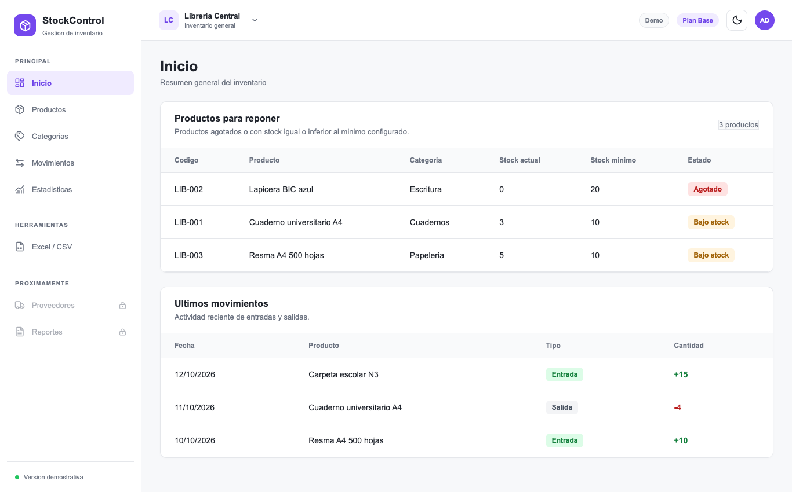
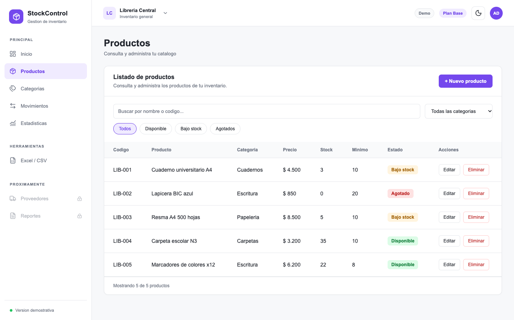
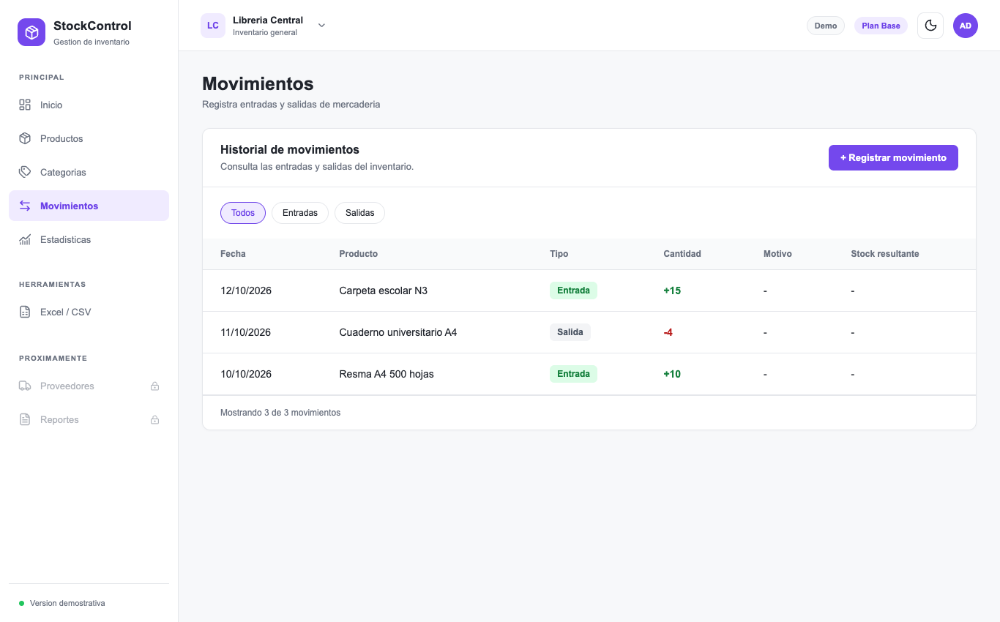
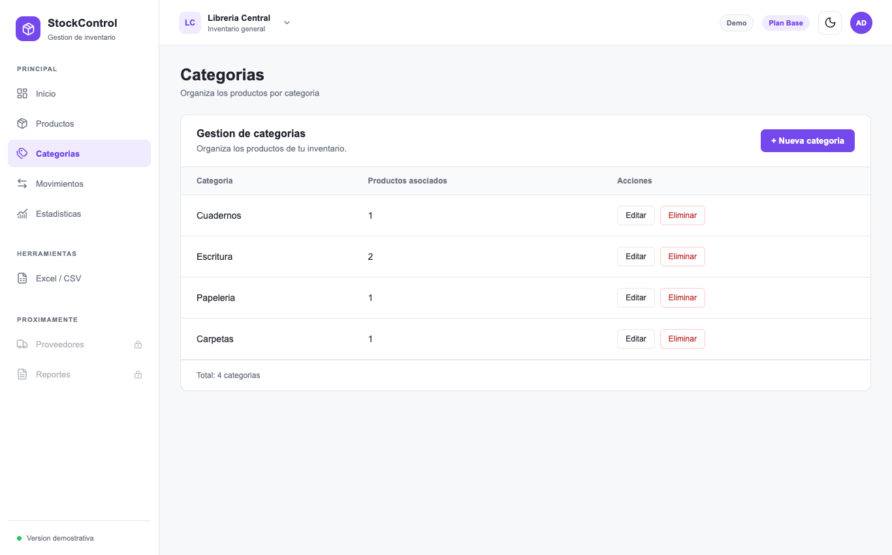
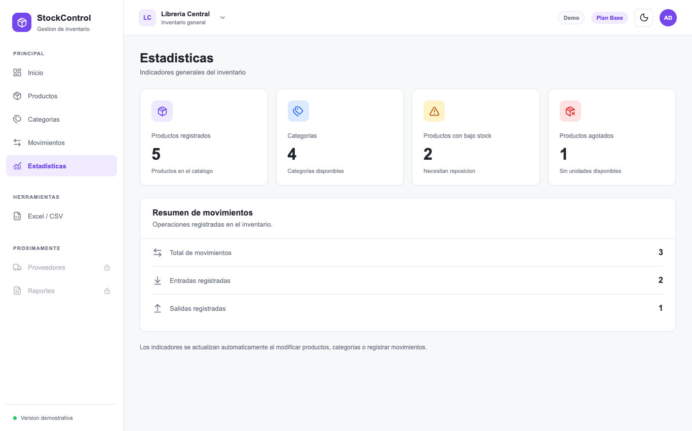
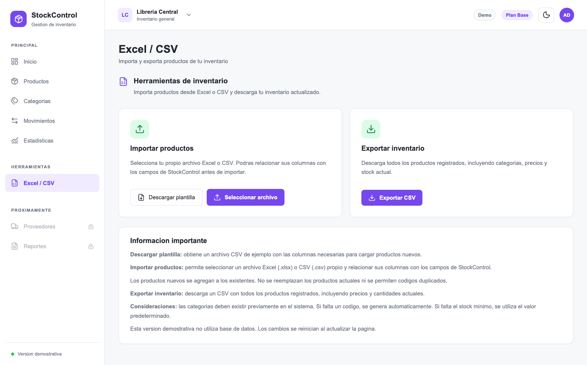
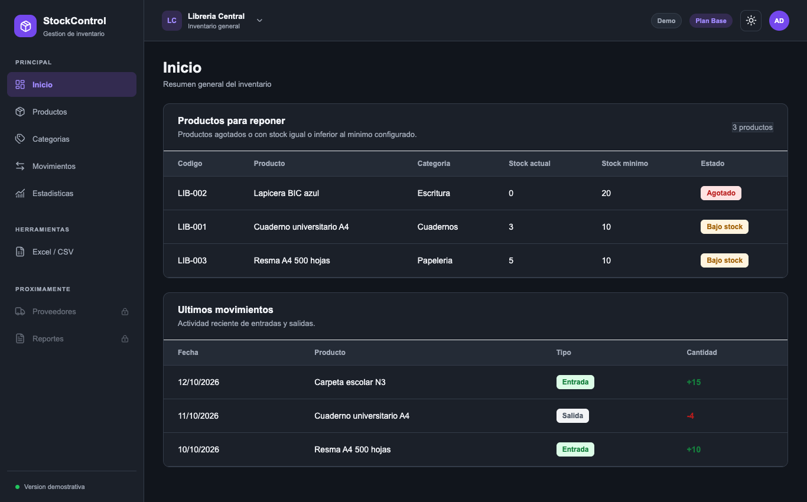

# StockControl — control de stock para pequeños comercios

Aplicación para administrar el inventario de un comercio: productos, categorías, entradas y salidas de mercadería, indicadores y planillas de Excel y CSV. Los datos de ejemplo son los de una librería ficticia.

> **Estado del proyecto:** es una **demostración solo de frontend**. No tiene backend ni base de datos: los datos viven en el estado de React y **se reinician al recargar la página**. Lo único que se recuerda entre visitas es el modo claro u oscuro. La idea es que sirva de base para un sistema real (ver "Próximos pasos").



## Capturas

| Productos (búsqueda y filtros) | Movimientos de stock |
|---|---|
|  |  |

| Categorías | Estadísticas |
|---|---|
|  |  |

| Importar y exportar Excel y CSV | Modo oscuro |
|---|---|
|  |  |

## Funcionalidades

- **Inicio:** los productos agotados o con stock bajo (los que hay que reponer) y los últimos movimientos.
- **Productos:** listado con búsqueda por nombre o código, filtro por categoría y por estado del stock (disponible, bajo stock y agotado). Alta y edición con formulario y baja con confirmación.
- **Movimientos:** registro de entradas y salidas con motivo. El stock se actualiza solo y el historial guarda el stock resultante de cada operación.
- **Categorías:** alta, edición y baja. Al renombrar una categoría se actualizan sus productos.
- **Estadísticas:** productos registrados, categorías, productos con bajo stock y agotados, y un resumen de movimientos. Se actualizan solos al modificar los datos.
- **Excel y CSV:** se importan productos desde un archivo `.xlsx` o `.csv` propio, relacionando sus columnas con los campos de StockControl antes de importar. También se descarga una plantilla de ejemplo y se exporta el inventario completo a CSV.
- **Modo claro y oscuro,** que se recuerda en el navegador.

## Reglas que valida

- **Productos:** todos los campos son obligatorios, el precio tiene que ser mayor a cero, los stocks tienen que ser enteros y no negativos, y **no se permiten códigos duplicados**.
- **Movimientos:** la cantidad tiene que ser un entero mayor a cero y **no se puede registrar una salida mayor al stock disponible**.
- **Categorías:** no puede haber nombres repetidos y **no se puede eliminar una categoría que tiene productos**.
- **Importación:** los productos nuevos se suman a los existentes sin reemplazarlos ni repetir códigos. Las categorías tienen que existir antes de importar, y si falta un código se genera solo.

## Tecnologías

| Parte | Qué se usa |
|---|---|
| Interfaz | React 19 y TypeScript, con Vite |
| Estado | Context API de React (un solo proveedor para productos, categorías y movimientos) |
| Estilos | CSS propio, sin librerías de componentes |
| Íconos | `lucide-react` |
| Planillas | `read-excel-file` para leer Excel; el CSV se lee y se genera a mano |

## Cómo correrlo

Requisitos: Node.js y npm.

```bash
npm install
npm run dev        # servidor de desarrollo
npm run build      # chequeo de tipos y build de producción
npm run lint       # ESLint
```

## Estructura

```
src/
  context/   Estado compartido del inventario (productos, categorías y movimientos) y sus reglas
  data/      Datos de ejemplo de la librería
  pages/     Una pantalla por sección: Inicio, Productos, Categorías, Movimientos, Estadísticas y Excel/CSV
  App.tsx    Barra lateral, barra superior y cambio de sección (sin librería de rutas)
```

## Decisiones de diseño

- **Las reglas de negocio viven en el contexto, no en las pantallas.** Las funciones del contexto (por ejemplo, registrar un movimiento) validan y devuelven el mensaje de error, y las pantallas solo lo muestran. Así una regla está en un solo lugar.
- **Después de crear un producto, su stock solo cambia a través de un movimiento.** Al editar un producto se conserva el stock actual, y cada entrada o salida actualiza el stock y queda registrada con el stock resultante.
- **Sin router:** con seis secciones alcanza con guardar la sección actual en el estado.

## Próximos pasos

- **Persistencia:** hoy los datos se pierden al recargar. El paso natural es una API REST (por ejemplo, Java con Spring Boot y MySQL) que guarde el inventario. No está hecha.
- **Proveedores y Reportes** figuran en el menú como "Próximamente".
- **Tests automáticos** de las reglas del contexto.
